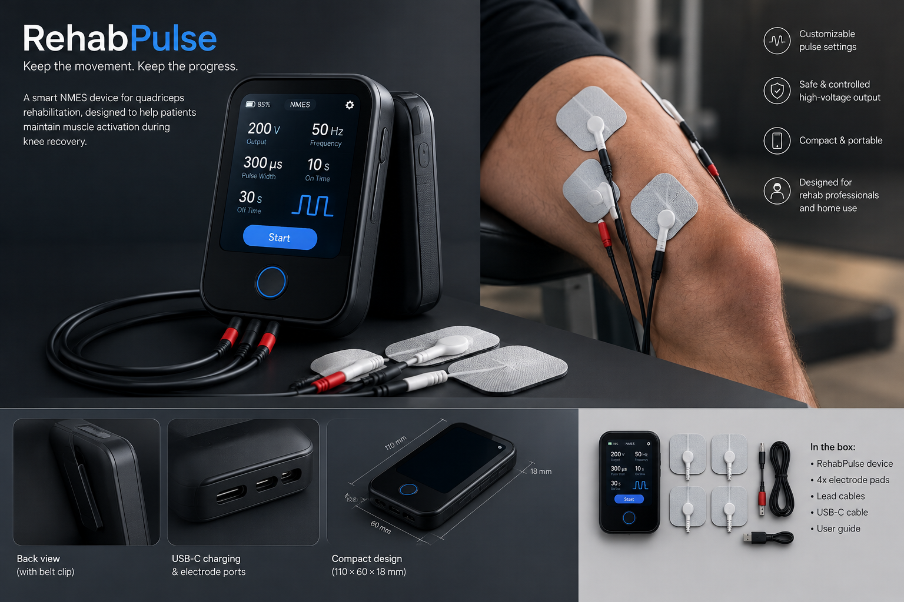
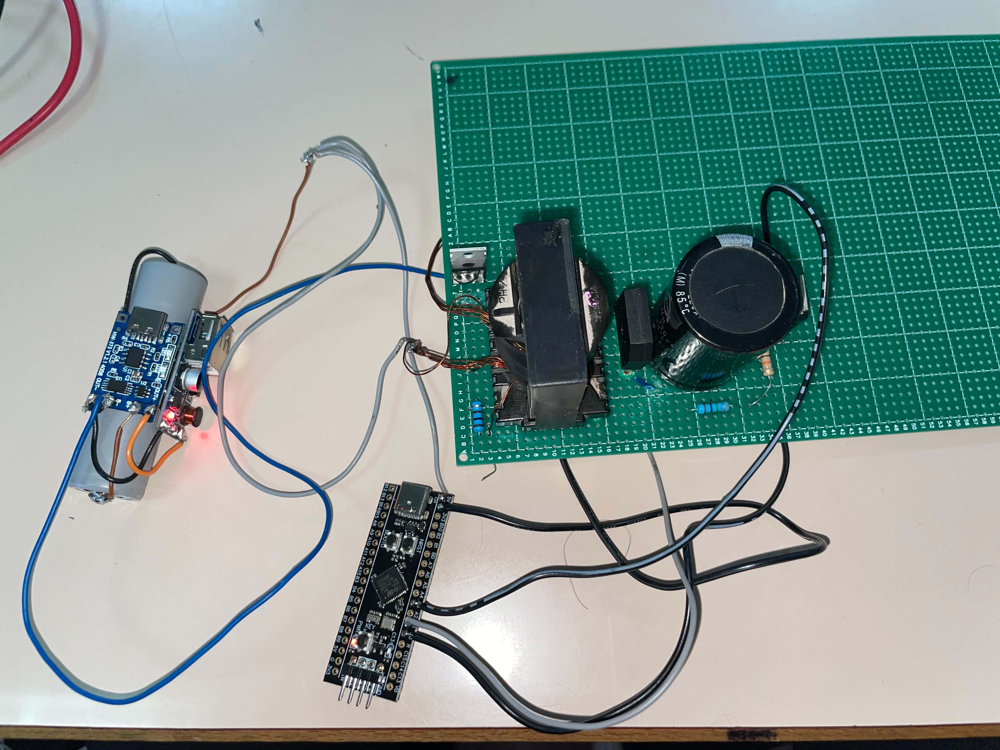
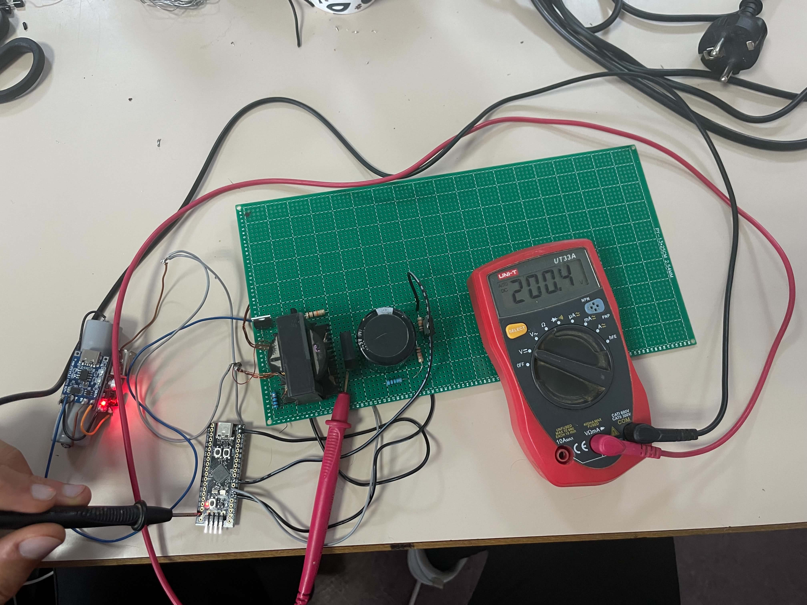

<div align="center">

# RehabPulse
### Quadriceps NMES Rehabilitation — Engineering Prototype

**Exploring controlled electrical pulse generation for a future quadriceps rehabilitation device.**


</div>

---

## Overview

RehabPulse is an engineering prototype exploring a microcontroller-controlled electrical pulse generator as the basis for a potential neuromuscular electrical stimulation (NMES) platform for quadriceps rehabilitation.

The motivation is to investigate ways to support muscle activation during periods when voluntary exercise is limited, including selected stages of knee rehabilitation. NMES is an established rehabilitation technique, but the safety and effectiveness of this specific prototype have **not** been clinically established.

> **Current status:** electronics prototype and product concept only. It is not a clinically validated or approved medical device and must not be connected to a person.

## Product concept


## Actual Prototype

### Hardware and circuit


### Additional project photos



*Illustrative design concept only. This image is not a photograph of a manufactured device. Any interface values or specifications shown in the concept image are not verified specifications of the current prototype.*

## The problem

After some knee injuries or surgeries, reduced movement can contribute to quadriceps weakness and muscle loss. NMES uses electrical pulses to stimulate motor nerves and produce muscle contractions. A potential product in this area must combine reliable electronics with appropriate clinical guidance, safety engineering, usability, and evidence of benefit.

## Current prototype architecture

The prototype is described as containing the following functional blocks. Confirm each description against the actual circuit and firmware before treating it as a verified implementation.

| Block | Role |
|---|---|
| High-voltage generator | Produces a nominal output of approximately 200 V in the current bench prototype |
| STM32 microcontroller | Controls the generator and pulse-switching logic |
| Voltage-feedback divider | Scales the generator output for monitoring by the controller |
| Transistor switching stage | Gates the output according to the controller's pulse command |
| Firmware control loop | Adjusts generator operation based on voltage feedback |

### Operating principle

1. The high-voltage generator develops its target output.
2. A resistor divider scales the output to a level suitable for the STM32's feedback input.
3. The controller uses feedback to regulate the generator.
4. A separate control signal drives the transistor switching stage to create timed output pulses.
5. The circuit is evaluated on a suitable test load using appropriately rated measurement equipment.

This description is a high-level overview, not a complete circuit design or a safety assessment.

## Repository contents

```text
RehabPulse/
├── README.md
├── .gitignore
└── assets/
    └── rehabpulse-product-concept.png
```

Add the actual schematic, firmware source, bill of materials, and test records as they become available. Do not imply that those files are included until they have been committed.

## Verification and test evidence

Measurements should be taken from the actual hardware and recorded with the test setup. Do not use generated illustrations as measurement evidence.

| Test | Result |
|---|---|
| Input supply voltage | Not yet documented here |
| No-load output voltage | Not yet documented here |
| Output under a specified test load | Not yet documented here |
| Output ripple / stability | Not yet documented here |
| Startup response | Not yet documented here |
| Pulse frequency and pulse width | Not yet documented here |
| Fault response and shutdown behavior | Not yet documented here |

For each real measurement, record the instrument, probe rating, test load, supply voltage, measurement point, and operating conditions. Attach genuine oscilloscope captures and clear photos of the prototype.

## Safety notice

**Do not connect this prototype to a person.** A nominal 200 V generator output does not establish the safety of a patient-facing stimulation output. Poorly designed or improperly applied electrical stimulation can cause serious injury.

Human use would require, at minimum, a qualified medical-device engineering review, documented risk analysis, verified output-current and charge limits, appropriate isolation and fault protection, output monitoring, suitable electrode and lead design, clinical oversight, and compliance with applicable medical-device requirements. Clinical suitability depends on the patient's injury, surgery, and rehabilitation plan.

## Potential business direction

The proposed initial customer segment is **rehabilitation clinics and hospitals**. Professional partners could help define requirements, evaluate usability, and determine what evidence is needed before a home-use product could be considered.

Potential future development stages:

1. Document and verify the bench electronics.
2. Review the design with qualified electrical-safety and rehabilitation professionals.
3. Establish test methods, fault handling, and measurable acceptance criteria.
4. Conduct appropriate safety and clinical validation.
5. Assess regulatory classification and commercialization requirements in the target market.

## Limitations

- The prototype's clinical effectiveness has not been established.
- The product concept image is illustrative and does not show verified hardware.
- No patient-use protocol or treatment settings are provided.
- No regulatory approval or certification is claimed.

## License

No license has been selected. Choose a license before public release. If you intend to protect commercial intellectual property, consider what technical details to disclose before publishing the repository.
